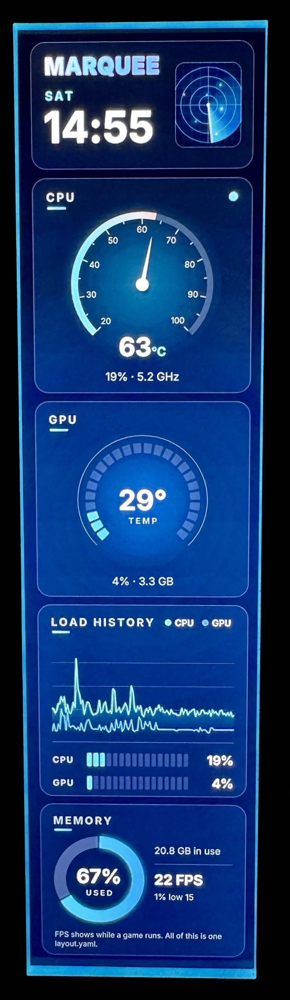
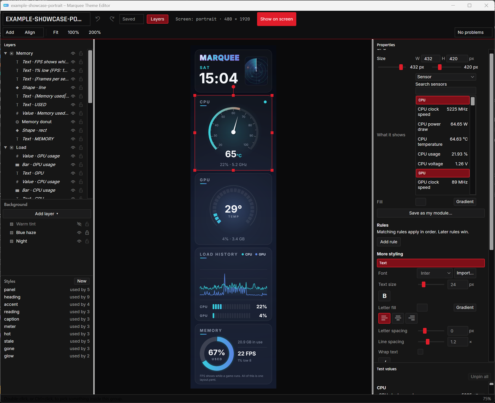

# Marquee

Marquee is a free, source-available Windows replacement for Lian Li's L-Connect **for the 8.8" Universal Screen and
its LED ring**. Make themes in a visual editor or in YAML, showing hardware sensors, game FPS and AI-agent usage
from Claude Code and Codex. L-Connect can keep managing your fans, pump and other RGB devices.

<p align="center"></p>

## Install

Download and run `Marquee-<version>-x64.msi` from [GitHub
Releases](https://github.com/madjagstudios/marquee/releases). It installs for every user and asks for
administrator rights once; the .NET runtime is included.

The MSI has no Authenticode signature yet, so an "unknown publisher" prompt from Windows is expected. If
SmartScreen appears, choose **More info → Run anyway**. The separate signature used to verify Marquee updates is
explained [below](#updates).

The installer adds:

- The tray app and **Marquee Theme Editor** to `C:\Program Files\Marquee`, with Start menu shortcuts.
- The `marquee` command to the system PATH, available in a new terminal.
- A logon task, `\Marquee\Marquee`, that starts the tray at sign-in with the highest rights your account has.
- An administrator-only data and update folder under `%ProgramData%\Marquee` (see [Logs](#logs)).

The tray starts after installation. Choose **Themes** and **Orientation** in its menu; without settings it shows
`example-landscape`. Game FPS and the L-Connect handover need administrator rights, which the logon task
supplies for administrator accounts (see [Without administrator rights](#without-administrator-rights)).

Installing a newer MSI upgrades in place and keeps your settings and themes. Uninstall from **Settings → Apps**:
Marquee closes the trays and removes the program, shortcuts, PATH entry, logon task and downloaded updates. Your
`%LOCALAPPDATA%\Marquee` settings and themes, and per-user logs and data under
`%ProgramData%\Marquee\users\<SID>`, remain so you can reinstall without losing them.

## L-Connect and the screen

Closing L-Connect's window doesn't free the screen; its background service keeps it open. Choose **Take over the
screen from L-Connect** in Marquee's tray menu to use the screen while L-Connect keeps managing your fans and RGB.
Taking over needs administrator rights; see [Sharing the screen with L-Connect](#sharing-the-screen-with-l-connect)
for setup and handover details.

## Making a theme

Choose **New theme…** in the tray or editor to start from **Blank**, **Gaming stats** or **System monitor**, or
**Open one of yours** on the start screen to open a theme folder. **Add** opens the module gallery and **Add layer ▾** opens the background gallery, both with live previews; select an item on the canvas to change what it
shows, its colour and size in the plain-language **Properties** panel. Follow the [theme guide](docs/themes.md)
to make your first theme and use **Show on screen** to select it for the running tray.



## Updates

With a release key built in, the tray looks for a newer Marquee once a day, the first time 5 minutes after it
starts, and remembers when it last looked (`last-update-check.txt` in its data folder), so restarting the PC
doesn't make it look again. That check is the only automatic outbound HTTP request made directly by Marquee: one
unauthenticated GitHub Releases API call, `GET
https://api.github.com/repos/madjagstudios/marquee/releases/latest`, with no account and no cookies. All it
sends about you is what any request does (your IP address) and a `User-Agent` header saying `Marquee/<version>`,
which GitHub requires. If the check fails, nothing else is affected, and it tries again the next day.

Manual checks and the installer/signature downloads you request also use the network. Separately, the Claude
usage provider runs the installed Claude CLI's `/usage` command, which can contact Anthropic; turn that polling
off with `providers: { claude_usage: off }`. Local sensor readings and Codex log reading need no outbound
request.

`updates: off` in `config.yaml` turns the daily check off. "Check for updates" in the tray's menu still checks
when you click it, whatever `updates:` says, and says what it found.

A newer version shows as a balloon and as "Install Marquee <version>…" in the menu. Nothing is downloaded until
you click one. Then the tray downloads the installer and its signature from the GitHub release into
`%ProgramData%\Marquee\updates`, a folder only administrators can change, with its progress in the status line.
It checks the signature against the public key built into Marquee, and only then runs the installer. A missing
or wrong signature means nothing is installed, and the log says why. How releases are signed is in
[docs/releasing.md](docs/releasing.md).

While the installer runs, the tray pauses: the screen and the ring go dark. The installer closes the tray,
replaces Marquee's files and starts the new tray. If the update doesn't install (you cancel it, another
installation is under way, or it fails and rolls back), the screen comes back and a balloon gives the
installer's exit code and its log, `%ProgramData%\Marquee\updates\Marquee-<version>-x64.msi.log`. The offer
stays in the menu, to try again. The next download replaces that log, and uninstalling removes it.

A tray without administrator rights can't install an update: its offer opens the release's page instead, to
download and run the installer from there. A development build with the placeholder in place of the release
key (see [docs/releasing.md](docs/releasing.md))
never checks or installs anything: "Check for updates" points to the releases page.

## How Marquee differs

Marquee draws the screen itself. L-Connect manages Lian Li hardware as well as its screens; LianliThemeEditor
edits themes **for L-Connect**, which still displays them. This comparison is for the 8.8" screen, at the time
of writing; "not verified" means we haven't established support, not that a feature is absent.

| | Marquee | L-Connect 3 | LianliThemeEditor |
|---|---|---|---|
| Theme format | `layout.yaml` plus local assets | L-Connect templates | L-Connect `.template`, `.turtheme` and compatible ZIP exports |
| Editor | Visual canvas, module/background galleries and YAML editing | Built-in screen/theme editor | Layer editing, grouping, undo/redo and recovery snapshots |
| Sensors | LibreHardwareMonitor or HWiNFO; custom values from scripts | Built-in hardware readings | L-Connect sensor data layers |
| Game FPS | PresentMon: FPS, frame time, 1% low and app name | An FPS sensor for 8.8" modular assets, off by default; no 1% low | Available sensor choices depend on L-Connect; FPS not verified here |
| AI-agent usage | Claude Code and Codex limits and sessions | None in its screen guide or changelog | None in its README or sensor labels |
| Screen LED ring | Theme-driven effects and rules, or a fixed colour/off | Screen lighting controls | Managed through L-Connect; independent ring control not verified |
| Licence | Source-available, free for personal and noncommercial use; see [licence](LICENSE) | No public source identified at the time of writing | Source on GitHub; no open-source licence identified at the time of writing |
| Price | Free | Free download | Free download (an MSI on its GitHub releases) |

Sources: [Lian Li's screen guide](https://lian-li.com/l-connect3/screensoftwareguide/), [L-Connect
downloads](https://lian-li.com/l-connect3/), [L-Connect's FPS
changelog](https://lian-li.com/l-connect3/l3-changelog/), [LianliThemeEditor's
README](https://github.com/ozgurce/LianliThemeEditor), [releases](https://github.com/ozgurce/LianliThemeEditor/releases)
and [editor sensor labels](https://github.com/ozgurce/LianliThemeEditor/blob/main/lang/en.json).

## Built with AI agents

Marquee is built by a small studio working with AI coding agents (Claude, Codex); changes go through review and
testing before release.

## Command line

    marquee devices
    marquee show-image <file> [--orientation portrait|portrait-flipped|landscape|landscape-flipped] [--brightness 0-100] [--repeat N] [--sink <folder>]
    marquee sensors [--sensors lhm|hwinfo|none] [--no-claude-usage] [--raw] [--config <file>]
    marquee run [<theme-folder>] [--orientation ...] [--fps 1-60] [--sensors lhm|hwinfo|none] [--preview] [--sink <folder>] [--frames N]
                [--http-port 1024-65535 | --no-http] [--no-claude-usage] [--no-fps] [--config <file>]
    marquee validate <theme-folder|zip> [--fps 1-60]
    marquee edit [<theme-folder>]   (opens the theme editor; see Theme editor)
    marquee push <key> <value> [--ttl 30s|5m|2h] [--port 1024-65535] [--config <file>]
    marquee setup-claude [--undo] [--dry-run]
    marquee task install [--tray <file>] | remove [--updates] | status | start [--user <SID>] | stop
    marquee claim-screen      (in an administrator terminal; see Sharing the screen with L-Connect)
    marquee statusline        (Claude Code runs this; see setup-claude)
    MarqueeTray.exe           (the tray; see The tray)

Settings not given on the command line come from `%LOCALAPPDATA%\Marquee\config.yaml`, or the file `--config` names
(see [Settings](#settings)); a `--sink` run reads only the file `--config` names.

`marquee run themes/example-landscape --preview` shows a theme on the screen and in a preview window (press `1` for 1:1).
Edit `layout.yaml` and save: the screen updates within a second. If the file has a mistake, the last good layout stays
on screen and the error, with its line number, shows in the console and the preview. `--sink <folder>` writes PNG
frames instead of using the screen, and keeps writing them until stopped (Ctrl+C) unless `--frames N` is given;
`--frames N` renders N frames and exits. `marquee run` without a folder shows the theme set in `config.yaml`.

A `--sink` run is for tests and for looking at a theme, and often runs beside the tray, so it keeps out of your setup:
it reads no `config.yaml` unless `--config` names one (so it needs a theme folder, and its frames are landscape unless
`--orientation` says otherwise), and it neither shows nor saves the last Claude Code limits. It still logs, like any
`marquee run`.

The command line's, the tray's, the preview's and the theme editor's messages are in resource files that can be
translated;
[docs/localization.md](docs/localization.md) says how to add a language.

### The logon task

`marquee task` looks after the logon task, `\Marquee\Marquee` in Task Scheduler, that starts the tray. The installer
runs it, so it is seldom needed by hand. All but `status` need an administrator terminal.

- `install` makes the task (or replaces it): at every sign-in, for every user, it starts the `MarqueeTray.exe` next to
  `marquee.exe` with the highest rights that user has. It refuses a tray that isn't under Program Files, because the
  task gives administrator rights to whoever can change that file; `--tray <file>` names another one (for
  development), with a warning when it is outside Program Files. It also makes `%ProgramData%\Marquee` (see
  [Logs](#logs)).
- `remove` deletes the task, and its folder in Task Scheduler. `--updates` deletes the downloaded updates too, as
  uninstalling does.
- `status` says whether the task is installed and what it starts, and exits 0 if it is and 1 if it isn't.
- `start` runs the task now in your sessions, or with `--user <SID>` in that user's, so the tray starts as it does at
  sign-in. For a user whose tray is running already, that opens its menu.
- `stop` closes every tray running from this folder, for every user, as the installer does before it changes any
  files. Each is asked to quit, and one still running after a minute is ended.

## Settings

`marquee run` and the tray read their settings from `%LOCALAPPDATA%\Marquee\config.yaml`. The file is optional, and so
is every key in it. Here is each key with its values; the comments give the defaults.

```yaml
theme: example-agents         # a theme folder's name or path; no default
orientation: landscape        # portrait | portrait-flipped | landscape | landscape-flipped; default landscape
fps: 30                       # 1-60; default: each theme's canvas.fps
sensors: lhm                  # lhm | hwinfo | none; default lhm
http: { port: 47913 }         # port 1024-65535, or http: off; default on, port 47913
providers: { claude: on, claude_usage: on, codex: on, fps: on }   # each on or off; default on
custom: { max_keys: 1000 }    # 1-10000; default 1000
ring: theme                   # theme | off | a quoted color like "#3A7BFF"; default theme
lconnect: { handover: off }   # off | ask | auto; default off
updates: check                # check | off; default check
```

- `theme` is the theme `marquee run` shows when no folder is given on its command line. Without either, it says so
  and exits; the tray shows `example-landscape` instead.
- `http` is the local server for [custom values](#custom-values): `http: off` turns it off.
- `providers` turns sources of values on and off: `claude` is the Claude Code session counts (`claude.sessions.*`),
  `claude_usage` the `/usage` poll for Claude Code's limits, `codex` the Codex limits and sessions, and `fps` the
  [game FPS](#game-fps).
- `custom.max_keys` is how many different `custom.*` keys a running Marquee holds.
- `ring` is the screen's LED ring: `theme` lets each theme set it, `off` keeps it dark, and a color shows that color
  for every theme. Quote the color: an unquoted `#` starts a comment.
- `lconnect.handover` controls the [L-Connect handover](#sharing-the-screen-with-l-connect).
- `updates: check` has the tray look for a newer release once a day; `updates: off` turns that off. See
  [Updates](#updates).

The tray writes `theme`, `orientation` and `lconnect.handover` when you pick them from its menu, changing only that
setting and keeping the rest of the file, comments included.

A command-line flag wins over `config.yaml`, `config.yaml` over the theme, and the theme over the default: `fps` in
`config.yaml` overrides every theme's `canvas.fps`, and `--fps` overrides both. `--no-http`, `--http-port`,
`--no-claude-usage` and `--no-fps` likewise win over `http` and `providers`. Orientation is the exception: a theme
never sets it (see [Orientation](#orientation)).

A rooted value, a value with `\` or `/` in it, or `.` or `..`, is a path, resolved relative to `config.yaml`'s folder.
Anything else is a theme name, looked for in `%LOCALAPPDATA%\Marquee\themes`, then in a `themes` folder beside
`marquee.exe`, then in `config.yaml`'s folder. On the command line, paths and that last lookup are relative to the
current folder.

`marquee run` reloads settings when you save `config.yaml`. It changes only the settings you edited: a theme or
frame-rate change keeps the screen on, orientation reopens it, and a provider or HTTP change restarts that part.
Invalid edits leave the previous settings active and log the error with its line number. At startup, an invalid
file uses the defaults instead. Command-line flags still win over these settings.

If a new theme fails to load, Marquee keeps the previous settings and watches the theme. Fixing and saving it
applies the waiting settings without another edit to `config.yaml`. If the theme can't be found, correct its name
or path in `config.yaml`.

`marquee sensors` reads `sensors` and `providers.claude_usage` from `config.yaml` too, and `marquee push` reads `http`.
`--config <file>` makes `run`, `sensors` and `push` read that file instead, to try settings out or keep several sets
side by side; `marquee run` then watches that file. A file named that way that doesn't exist gets a warning, and the
defaults are used.

## The tray

`MarqueeTray.exe` is Marquee's tray icon. It runs what `marquee run` runs, with no window and no command line: its
settings are `config.yaml`'s, and what `marquee run` would print goes to its [log](#logs). Its menu, from the top:

- **The status:** the theme, its frame rate and the screen, or what stops it (paused, waiting for the screen, L-Connect
  using it, a theme that didn't load). Under it, a line for each problem until it is fixed: an error in `config.yaml`
  or the theme, game FPS off, a source of values that is failing (LibreHardwareMonitor or PresentMon missing, `claude`
  not found, and so on), or why taking the screen from L-Connect failed. An error in `config.yaml`, the theme or a
  handover also shows as a balloon, at most once a minute for each.
- **Themes** and **Orientation:** your themes, then the installed examples, and the four orientations. Picking one
  writes `theme:` or `orientation:` to `config.yaml`, changing only that setting, then shows it.
- **Open preview**, **Edit theme…** (the theme on show in the [theme editor](#theme-editor)), **New theme…** (the
  [start screen](#making-a-theme)), **Open themes folder**
  (`%LOCALAPPDATA%\Marquee\themes`, made if it isn't there), **Open logs** and **Edit settings** (`config.yaml` in your
  editor; if there is none, one naming the theme on show is written first).
- **Take over the screen from L-Connect** and **Always take over at start** (see
  [Sharing the screen with L-Connect](#sharing-the-screen-with-l-connect)).
- **Pause** lets go of the screen, so another program (L-Connect, or `marquee run`) can have it, and turns the ring
  off. **Resume** takes it back.
- **Check for updates**, or **Install Marquee <version>…** once there is one (see [Updates](#updates)).
- **About Marquee** and **Quit.** Quit lets go of the screen, darkens the ring, saves the Claude Code limits and ends
  the tray until you next sign in. The Start menu's "Marquee" starts it again, but without administrator rights (see
  [below](#without-administrator-rights)); `marquee task start` in an administrator terminal starts it as signing in
  does.

The first time, with no `config.yaml`, the tray shows `example-landscape` and a balloon says to pick your theme and the
screen's orientation from its menu. That balloon shows once; it waits for a later start if L-Connect has the screen
(the [handover's offer](#sharing-the-screen-with-l-connect) comes first) or if `config.yaml` has an error (whose
balloon comes instead). A `config.yaml` without a `theme:` line shows `example-landscape` too.

`marquee run` while the tray is showing the screen says so and stops: pause the tray, or quit it, first.

The logon task starts the tray as administrator, which game FPS and the L-Connect handover need. Files, folders
and web pages open through Explorer with your normal rights. Logs and data use the administrator-only folder
described in [Logs](#logs).

If Explorer isn't running, the tray can't open files or web pages and shows a balloon instead. The tray won't write
`config.yaml`, or make a missing folder, through a junction or symbolic link, which could send an administrator's
write somewhere else. It won't edit a `config.yaml` that is a hard link either, since reading it as administrator
could expose a file you can't otherwise read. The balloon and log explain a refused write; you can edit the file by
hand. An existing themes folder that is a junction can still be opened.

### Without administrator rights

For a user who isn't an administrator, the logon task starts the tray with their own rights; so does the Start menu
when no tray is running. That tray shows themes as usual, but game FPS and the L-Connect handover are off, and its menu
says why: "Game FPS is off: Marquee isn't running as administrator." and, while L-Connect has the screen, that Marquee
can take it only as administrator. It can't install updates either: its update offer opens the release's page.
`marquee claim-screen` in an administrator terminal still hands it the screen once. To have an administrator's tray
back, quit this one and run `marquee task start` in an administrator terminal.

### More than one user

Every user who signs in gets a tray of their own, with their own `config.yaml`, themes and folders, and one tray each:
starting it again opens the running one's menu. There is one screen, though: the first tray to open it keeps it until
it pauses or quits, and the others wait for it.

## Sharing the screen with L-Connect

Only one program can drive the screen at a time. L-Connect 3's background service holds it, and closing the
L-Connect 3 window doesn't free it. Marquee can take the screen over while L-Connect keeps running your fans and RGB:
it stops L-Connect's service watcher and service, opens the screen, and starts them again straight away. L-Connect then
skips the screen and goes on running everything else. The cost is a pause of a few seconds while the service is
stopped, in which your fans keep their last speed and L-Connect doesn't adjust them or the RGB. Marquee waits up to 15
seconds for the watcher, then the service, to stop. It never stops another service that depends on L-Connect's: if one
is running, the handover fails and L-Connect keeps the screen. Pausing or quitting Marquee during a handover (an install
closing the tray included) starts L-Connect again at once, and doesn't count as a failure.

`lconnect.handover` in [`config.yaml`](#settings) says when Marquee does this:

- `off` (the default): not on its own. While L-Connect has the screen, the tray's menu still offers "Take over the
  screen from L-Connect". The first time L-Connect holds the screen, a user who hasn't set `lconnect.handover` gets the
  `ask` balloon below, once, so that they hear the handover exists. Its click takes the screen this once, and it adds:
  "To do this at every start, choose "Always take over at start" in Marquee's menu." Writing
  `lconnect: { handover: off }` yourself turns that balloon off too. Without the tray, the log explains the manual
  handover below.
- `ask`: whenever Marquee finds L-Connect using the screen, the tray shows a balloon: "L-Connect is using the screen.
  Marquee can take it over while L-Connect keeps running your fans and RGB. Click here to take over." Clicking it does.
- `auto`: at start, and whenever Marquee finds the screen busy again (after you unplug it, say). Failed attempts
  retry after 1, 2 and 5 minutes, then every 10 minutes while L-Connect's service holds the screen. Opening the screen
  or pausing Marquee resets that schedule. **Take over the screen from L-Connect** bypasses the wait. This also
  applies to `marquee run`.

The tray's "Always take over at start" item writes `lconnect.handover: auto` to `config.yaml` when you check it, and
`ask` when you uncheck it. Checking it while L-Connect has the screen also takes the screen at once, rather than at the
next time it is found busy. It shows only where L-Connect is installed, or while it is checked, so it can be turned off.
"Take over the screen from L-Connect" shows only while L-Connect has the screen, in any mode, and does nothing once
Marquee has it. A handover that fails says why in a balloon (with `auto`, that Marquee will keep trying) and in a menu
line until Marquee gets the screen.

Stopping L-Connect's service takes administrator rights. The tray has them when its logon task starts it. A tray
without them offers neither item, and while L-Connect has the screen its menu says why; a `marquee run` without them
says once in its log that it can't take the screen over. `marquee claim-screen`, run in an administrator terminal,
takes the screen once for a Marquee without those rights (a `marquee run` in another window, or such a tray): it stops
L-Connect, waits until that Marquee has the screen (15 seconds at most), and starts L-Connect again. It does nothing
when no Marquee is running, or when Marquee has the screen already.

To turn the handover off, set `lconnect: { handover: off }`. It changes nothing in L-Connect itself.

By hand, with the handover off:

1. Right-click L-Connect's tray icon and choose its stop-service option. Ending the service in Task Manager doesn't
   stick: a watcher service starts it again. Fans keep their last settings meanwhile.
2. Start Marquee (`marquee run …`, or Resume in the tray) and wait for the picture.
3. Start the service again from the same tray menu. L-Connect skips the screen and goes on running your fans and RGB.

While Marquee has the screen, L-Connect doesn't control it or its LED ring, and neither shows up in the L-Connect app.
To give the screen back, pause or quit Marquee, then stop and start the service from the tray again.

## Orientation

Pick the orientation that matches how the screen is mounted, with `--orientation` or `orientation:` in `config.yaml`. A
vertical mount is `portrait`; a horizontal mount is `landscape` (the default). If the picture comes out upside down,
use the `-flipped` variant.
Layouts are designed at 480×1920 (portrait) or 1920×480 (landscape). A theme declares which one it was designed
for; running it on the other shape prints a warning and shows it scaled down rather than stretched. The theme's shape
never changes the orientation: that is how the screen is mounted, which only you know.

## Themes

Start with the [theme guide](docs/themes.md) for the visual editor and a first YAML theme; the [key reference](docs/keys.md) lists the readings you can use.

A theme is a folder with a `layout.yaml` and any images or fonts it uses. A small example:

```yaml
canvas: { orientation: landscape, fps: 30 }
styles:
  big: { size: 84, weight: bold, color: "#F4F6FA" }
  hot: { color: "#FF5A36", glow: { color: "#FF5A36", radius: 16 }, pulse: { property: glow, period: 1200 } }
background:
  - fill: { linear: ["#070A12", "#141B2E"], angle: 90 }
widgets:
  - type: value
    at: [40, 40]
    size: [300, 110]
    source: cpu.temp
    format: "{0:0}°C"
    smooth: 400
    style: big
    when:
      - { above: 85, style: hot }
      - { stale: true, style: { color: "#5A6275" } }
```

- **Widgets:** `text` (templates like `"{gpu.load:0}% · {gpu.vram_used|bytes}"`), `value`, `bar`, `gauge`, `graph`, `image`,
  `video` (a clip in a box), `shape` (a `rect`, `ellipse`, `line` or `arc`, which `when` rules can recolor), `donut`
  (a pie or donut of up to 12 slices), `group`.
- **Styles:** named in `styles:`, layered with `extends:`, changed by `when:` rules (`above`, `below`, `equals`, `stale`), animated with `pulse:`.
  Letter effects: an outline (`text_stroke`), a color or gradient for the letters alone (`text_fill`), `italic`,
  `underline`, `strike` and `case` (`upper`, `lower` or `title`).
- **Background:** `fill` (color or gradient), `image`, `shader` and `video` layers, each with `opacity` and `blend`; up
  to 16 layers, at most 4 of them shaders and 2 of them videos.
- **Colors** are quoted CSS hex (`"#RRGGBB"` or `"#RRGGBBAA"`): an unquoted `#` starts a YAML comment.
- **Gradients** go in `fill`, `track`, a stroke's `color` and fill layers:
  `{ linear: ["#000000", "#36D1DC", "#FFFFFF"], stops: [0, 0.8, 1], angle: 90 }` or
  `{ radial: ["#FFFFFF60", "#00000000"], center: [0.3, 0.4], radius: 0.8 }`. `stops` place the colors, and a radial
  gradient's `center` and `radius` move and size it.
- **Fonts:** the bundled Inter by default, an installed font by name, or a `.ttf`/`.otf` file in the theme folder.
  Characters the font lacks, such as Japanese with Inter, are drawn with a Windows font that has them. Those are the
  right letters, but Arabic letters aren't joined yet, Arabic and Hebrew run left to right, and Indic marks aren't yet
  moved into place. Color emoji keep their own colors, and take no glow, shadow or outline.
- **Names:** `name` (up to 64 characters) on a widget or a background layer is what the theme editor's layers list
  calls it; the screen ignores it.
- **Times:** `resets_at` and `updated_at` keys are Unix seconds and `now` is the current time, so
  `"{claude.five_hour.resets_at - now|duration}"` reads "2h 14m". `"{now|time}"` is the local short time, and
  `"{now|time:ddd HH:mm}"` or a value's `format: "time:HH:mm"` takes a .NET date and time pattern. Times follow the
  PC's time zone and regional format (day and month names, the short time, a 24-hour clock), as the taskbar clock does.
  Letters in a pattern are pattern letters, so quote words (`"{now|time:'Today is' dddd}"`) and write a letter alone
  as `%H` (`"{now|time:%H}"`). The pattern runs to the closing brace, so spaces before the brace are kept.

A value with a smaller unit, such as a big "52" with a small "°C", is a value widget with `spans` instead of
`format`. Each span has its own template and style, and they share a baseline, so the unit stays beside the number as
the number's width changes. `{0}` is the widget's value after `smooth` (`{0:0.0}` formats it), and other placeholders
still read their keys. A missing value shows a single "—" in the first span's style. The widget's style places the
spans, and its `when` rules change every span:

```yaml
- type: value
  at: [140, 500]
  size: [300, 90]
  source: cpu.temp
  smooth: 400
  style: { size: 72, color: "#F4F6FA", align: center }
  spans:
    - { text: "{0:0}" }
    - { text: "°C", style: { size: 30, color: "#36D1DC" } }
  when:
    - { above: 85, style: { color: "#FF5A36" } }
```

A text widget takes `spans` instead of `text` in the same way, for words in several styles; its placeholders show
each reading as it comes, as a text widget's always do, since only a value widget's `{0}` follows `smooth`. A span's
style sets how its letters look. The box keys (`fill`, `stroke`, `radius`, `padding`, `align`, `wrap`, `line_height`,
`opacity`, `blend` and `pulse`) are the widget's: a span's own style can't set them, and a named style's are left out.

Every key, with its values and default, is in [docs/themes-reference.md](docs/themes-reference.md). VS Code completes
and checks theme files once the YAML extension (Red Hat) is installed: the examples' first line,
`# yaml-language-server: $schema=../../docs/layout.schema.json`, points it at [the schema](docs/layout.schema.json).
For a copied theme, point that first line at a local copy of the schema or use the public URL:

```yaml
# yaml-language-server: $schema=https://raw.githubusercontent.com/madjagstudios/marquee/main/docs/layout.schema.json
```

See `themes/example-landscape`, `themes/example-portrait`, `themes/example-agents`, and `themes/example-showcase`
with `themes/example-showcase-portrait` for a vertically mounted screen. The showcase includes a clock with the
weekday, an outlined gradient title, a video box, a number with a small unit, shapes, dials, segmented meters,
charts, a donut, wrapped text, rotation, blending, names and hidden widgets. See the
[theme authoring guide](docs/themes.md) for the full walkthrough.

### Shader backgrounds

A `shader` layer runs an [SkSL](https://skia.org/docs/user/sksl/) file from the theme folder over the whole canvas.
Marquee sets `uniform float time` (seconds), `uniform float day` (whole days) and `uniform float2 resolution` (pixels);
declare only the ones a shader uses. `time` wraps back to 0 once a day so it stays precise, and `day` counts up by one
at the same moment. A cycle whose period divides a day (a minute, an hour) carries on across the wrap with `time`
alone; for any other period, add the day's offset: `fract(fract(day * 86400.0 / period) + time / period)`. Bind any
other uniform to a number or an expression, one value
per component. Marquee binds floats only, so declare bound uniforms as `float`, `float2`, `float3` or `float4`; a layer
that binds an `int` uniform is skipped with a warning (an unbound one only gets the warning that it stays 0). A binding
whose sensor is missing or stale reads as 0.

```yaml
background:
  - shader: shaders/aurora.sksl
    uniforms:
      heat: "clamp(max(cpu.load, gpu.load) / 100, 0, 1)"   # float
      tint: [0.2, 0.5, "gpu.load / 100"]                 # float3
    scale: 0.5        # render at half size and stretch it up (0.1–1, default 1)
    opacity: 0.55
    blend: screen
```

Shaders run on the CPU. A smooth full-canvas shader costs about 10–15 ms per frame at `scale: 0.5`; Marquee draws the
next frame while the last one goes to the screen, so 30 fps holds, and it prints a warning if a theme can't keep up.
A shader that takes too long would freeze the screen, so when a theme loads Marquee renders each shader layer once at
1/8 of its size each way and estimates what a full frame costs. A layer whose estimate is over the frame budget
(1000 ms divided by the fps, from `canvas.fps` or `--fps`) is skipped, with its estimated cost in the console and the
preview; lower its `scale` or the fps, or simplify the shader. The budget is per layer, and the test frame runs with
`time`, `day` and bound uniforms at 0. Marquee never lowers a layer's scale on its own.
A shader that doesn't compile is skipped with the error in the console and the preview, and editing the `.sksl` file
reloads the theme like editing `layout.yaml`.

### Video backgrounds

A `video` layer plays a clip from the theme folder, over and over for as long as the theme shows.

```yaml
background:
  - video: clips/rain.mp4
    fit: cover        # cover | contain | stretch | none, as for images (default cover)
    opacity: 0.8
    blend: screen
```

MP4, M4V, MOV and WMV clips go through Windows' own decoder (Media Foundation), so nothing is bundled for them. H.264
needs nothing extra; HEVC, VP9 and AV1 need Microsoft's extension for that format from the Microsoft Store. Animated
GIF and WebP go through Skia. Any other extension is an error in `layout.yaml`, with its line.

A `video` widget plays a clip the same way inside a box of its own, over the style's `fill` and under its stroke,
clipped to its `radius`. Its `shadow` is the box's, as an `image` widget's is, so a clip that leaves part of the box
empty still casts the whole box's shadow:

```yaml
- type: video
  at: [470, 130]
  size: [360, 210]
  src: video/tunnel.mp4
  fit: cover          # as for a layer (default cover)
  style: { radius: 8, stroke: { width: 2, color: "#FFFFFF40" } }
```

A theme can have at most 2 video layers, and at most 4 videos in all, counting its video layers and video widgets
together; a hidden one isn't loaded, but it counts. A video widget's box can cover at most as many pixels as the
canvas (1920×480). A clip's file can be up to 200 MB, and its frames up to 3840×2160 either way round (2160×3840
suits a portrait theme). Each clip is decoded on its own thread, a few frames ahead and scaled to the
size it is drawn at, and the layer draws the frame for the current time, so drawing never waits on decoding and the
clip plays at its own speed.

A clip that can't be played skips its layer, with a warning in the console and the preview that says why: the file is
missing or over a limit, Windows has no decoder for its format, it is damaged, or Media Foundation isn't there at all
(Windows N editions need the Media Feature Pack, from Settings > System > Optional features). When the theme loads,
Marquee also times a few frames of each clip and skips one that decodes slower than it plays; a smaller clip, or one
with fewer frames per second, fixes that. A clip that fails partway through stays on its last good frame, and the
reason is logged once. Saving over a clip reloads the theme, like editing `layout.yaml`.

### LED ring

The screen's ring of 60 LEDs is set by a theme's `ring:` block:

```yaml
ring:
  color: "#3A7BFF"
  effect: breathe            # static | breathe | spin | rainbow
  speed: 1.0                 # 0.1-10
  brightness: 80             # 0-100
  source: cpu.temp
  when:
    - { above: 85, color: "#FF3A2E", effect: static }
```

- **Effects:** `static` is the color on every LED; `breathe` fades it between a fifth of the brightness and full,
  every 3 seconds; `spin` sends a bright segment with a fading tail round the ring, once every 2 seconds; `rainbow`
  spreads the hues round the ring and turns them, once every 6 seconds, ignoring `color`. `speed: 2` is twice as fast.
- **`when` rules** work as a widget's do (`above`, `below`, `equals`, `stale`), comparing the ring's `source`, and
  change any of `color`, `effect`, `speed` and `brightness`. Every matching rule applies, in order, so a later rule wins.
- **The default:** a theme without a `ring:` block shows a soft static warm white (`#FFF1E0` at 40%). A field a `ring:`
  block leaves out is `static`, white (`#FFFFFF`), speed 1 and brightness 100 instead, so `ring: { color: "#3A7BFF" }`
  shows that blue at full brightness.

`ring:` in `config.yaml` overrides every theme's ring: `ring: off` keeps it dark, and `ring: "#3A7BFF"` shows that
color on every LED, static, at full brightness. An alpha byte dims it: `"#3A7BFF80"` is about half as bright. Saving
`config.yaml` changes the ring at once, without restarting anything else.

Marquee updates the ring up to 30 times a second on a thread of its own, so the ring never slows the screen. A ring
that fails (held by another program, say) is tried again after 2 seconds, one that isn't plugged in is looked for
every 5 seconds, and a screen without one is fine. Taking the screen from L-Connect takes the ring too. The ring goes
dark when Marquee pauses or quits, and so while an update installs. `--sink` and `--frames` leave it alone.

### Theme editor

Open **Edit theme…** in the tray, **Marquee Theme Editor** in the Start menu, or `marquee edit` to edit the
configured theme; `marquee edit <theme or folder>` opens another. **New theme…** opens the start screen
described [above](#making-a-theme). The canvas uses the same renderer as the screen; the [theme
guide](docs/themes.md) walks through the galleries, **Properties**, **Layers**, styles, rules and test values.

`layout.yaml` stays the source of truth. Edits save automatically after about a second, preserving comments and
unrelated formatting. Hand edits reload as one undo step; undo keeps up to 500 steps, and a recovery copy
helps after a crash. Installed examples are read-only: make a copy to edit, or open one read-only to look around.

**Show on screen** writes the selected theme to `config.yaml`; a running tray follows that setting and
subsequent saves. The editor runs as you and refuses to start as administrator.

### Checking a theme

    marquee validate themes/example-agents
    marquee validate neon.zip --fps 60
    marquee validate my-theme

A bare name is looked up where `marquee run` looks for one (see Settings). `marquee validate` loads a theme the way
`marquee run` does, but it lists every problem instead of stopping at the
first: each independent mistake in `layout.yaml` with its line; images, fonts, shaders and clips that are missing or
can't be used; shaders that don't compile or are over the frame budget (at `--fps` if given, otherwise the theme's
`canvas.fps`); clips that can't be decoded or can't keep up; files over the limits below; and symbolic links or
junctions, which it doesn't follow. Anything `marquee run` would skip is an error. Anything it works around, such as a
font that isn't installed or a shader uniform left unbound, is a warning. It needs no screen and no `config.yaml`.

It prints one problem a line, sorted by file and then line, and ends with the theme's name, the orientation and size it
is designed for, and the counts:

    layout.yaml:4: error: fill: 'nope' is not a color. Use "#RRGGBB", "#RRGGBBAA" or "transparent"
    layout.yaml: warning: Font 'NoSuchFamily123' is not installed on this PC; using Inter instead.
    logo.png: error: Image 'logo.png' was not found and was skipped.
    neon (landscape, 1920×480): 2 errors, 1 warning.

It exits 0 when there are no errors (warnings alone are fine) and 1 when there are any.

A theme, in a folder or a zip, can have at most 1,000 files, each up to 200 MB and 512 MB in all. A zip holds the theme
at its top level (`layout.yaml` next to everything else) or in its one top-level folder. A zip file over 512 MB, or one
listing more than 1,000 entries, is refused before its entries are read. Before anything is extracted, Marquee checks
every entry: its name must stay inside the theme, it must not be a link, and it must not expand more
than 100 times its compressed size (the mark of a zip bomb). The zip is extracted into a temporary folder, which is
deleted afterwards. `marquee validate` never changes the theme or the zip.

Run as administrator, `marquee validate` refuses a zip: it would unpack it into your temp folder, which your other
programs can change. Validate the zip from a normal terminal, or unzip it and validate the folder. Folders and theme
names are checked as usual.

## Claude Code and Codex

`marquee run` reads Claude Code and Codex status automatically. See the [sensor key reference](docs/keys.md).

Marquee checks Claude Code's usage limits every 5 minutes with `claude -p /usage` (no model call or cost). This
needs a native `claude.exe` installation or the desktop app's bundled copy, logged in to a claude.ai subscription.
API-key sessions have no usage limits. Setting `providers: { claude_usage: off }` in `config.yaml`, or passing
`--no-claude-usage` to `marquee run` or `marquee sensors`, turns the poll off.

When Marquee runs elevated, it starts `claude` with your normal rights through Explorer. If it can't (Explorer isn't
running, or belongs to another account), it logs the problem and uses only status-line updates. The child runs with its auto-updater disabled and stops
when Marquee exits.

**Troubleshooting:** Marquee uses the account logged in to the `claude` command line, which can differ from the
desktop app's account. Check `/status` in a terminal Claude session and use `/login` to match accounts. An npm-only
installation supplies `claude.cmd`, which Marquee cannot run; use the native installer or desktop app.

When Claude Code can't fetch fresh limits (`/usage` then falls back to its last-known bars and lists none), Marquee
writes nothing, keeps the last values until they reset, and logs that once. It then checks less often, after 5, 10 and
20 minutes and then every 30, and goes back to every 5 minutes once fresh limits arrive (and logs that it is working
again).

Claude Code also hands its limits, and the context-window percentage, to its status-line command as a session runs,
which updates them sooner than the 5-minute poll. To use that, run `marquee setup-claude` once, from `marquee.exe`
itself (setup refuses to run from anything else; `--undo` runs from anywhere). It points Claude Code's `statusLine` at
`marquee statusline`, which hands the data to Marquee and then runs your previous status-line command, so your status
line looks the same as before. It edits only `statusLine` in `~/.claude/settings.json`, keeps a timestamped backup, and
`marquee setup-claude --undo` puts the old setting back. `--dry-run` shows the change first. If it can't rewrite
`settings.json` exactly (comments, trailing commas, repeated keys, a file that isn't UTF-8, a link, or a `statusLine`
that isn't an object), it changes nothing and says why. A project's `.claude/settings.json` or managed settings with
their own `statusLine` win over this one.

Status-line updates arrive while Marquee is running and a terminal Claude Code session is updating its status
line. Only programs running as your Windows account can send them. The desktop app's Code tab does not run status
lines, so Marquee relies on the `/usage` poll. If `claude` is missing, logged out or fails, Marquee logs the problem once
and retries after 5 minutes.

`marquee run` and the tray keep the last limits across restarts in `%LOCALAPPDATA%\Marquee\claude-limits.json`, or,
running as administrator, in `%ProgramData%\Marquee\users\<your SID>\claude-limits.json` (see [Logs](#logs) for why).
The file holds only
each window's percentage and reset time and when they were read (no login or account details). It saves them whenever
they change and when it stops, and loads them at start, so the bars show at once, with `claude.updated_at` still saying
how old they are. A window that reset while Marquee was stopped stays stale (`—`), and a window without a reset time
isn't saved, nor is the per-model weekly limit (it shows after the first `/usage` poll). Fresh values from `/usage` or
the status line replace the loaded ones as they arrive. A missing or
unreadable file is skipped with one log line; deleting it is safe. A `--sink` run neither loads nor saves them.

The session files and Codex logs are undocumented formats that may change. If Marquee can't read them any more, it
logs a warning and those keys go stale; everything else keeps working.

## Custom values

Scripts can send `custom.*` readings with `marquee push` or HTTP. See the [Custom](docs/keys.md#custom) section of the sensor key reference.

## Hardware sensors

`marquee sensors` lists current readings; `marquee sensors --raw` also lists the hardware source's unmapped readings.
See the [Hardware](docs/keys.md#hardware-cpu-gpu-ram-fans-and-voltages) section of the sensor key reference.

Choose the source with `--sensors` or `sensors:` in `config.yaml`:

- **LibreHardwareMonitor** (`lhm`, the default) reads sensors directly. CPU temperatures and motherboard sensors
  need administrator rights and the [PawnIO](https://pawnio.eu/) driver, which you install separately.
- **HWiNFO** (`hwinfo`) reads HWiNFO's shared memory. Start HWiNFO and enable **Settings → Shared Memory Support**.
  Some AMD cards, such as the Radeon RX 7800 XT, give no temperature, clock or power through LibreHardwareMonitor;
  HWiNFO reads those.

## Game FPS

`marquee run` measures the game in front. See the [FPS](docs/keys.md#fps) section of the sensor key reference.
The foreground process is checked every 250 ms; if it has several swap chains, Marquee measures the one
with the most frames in the last second.

Frames are counted by [PresentMon](https://github.com/GameTechDev/PresentMon) 2.6.0, Intel's open-source frame-time
tool (MIT). It is bundled next to `marquee.exe` as `PresentMon\PresentMon-2.6.0-x64.exe`, and Marquee checks its SHA-256
before every start and won't start a file that doesn't match. It runs without a window as Marquee's child and ends with
Marquee, even if Marquee crashes. If it exits, Marquee logs why and starts it again. Building Marquee downloads it once
from its GitHub release into `.cache\presentmon` and checks the same hash.

PresentMon reads Windows' event tracing, which needs administrator rights, so FPS works only when Marquee runs as
administrator: the tray does when its logon task starts it, and `marquee run` does from an elevated terminal.
Unelevated, FPS is off with a warning saying why (in the tray's menu, too). `providers: { fps: off }` in `config.yaml`
or `--no-fps` turns FPS off, and the warning with it.

## Logs

`marquee run` writes what it prints to `%LOCALAPPDATA%\Marquee\logs\marquee-YYYYMMDD.log` as well, and so does the
tray (with no console of its own), one file per day, so a problem can still be read after the console
is closed. The files of the last 7 days, today's included, are kept; older ones are deleted. A day's file stops at
10 MB, with a last line saying so, and logging carries on in the next day's file. The file can be opened while
Marquee runs. "Open logs" in the tray's menu opens the folder.

Running as administrator (the tray from its logon task, or `marquee run` from an elevated terminal), Marquee keeps its
log and its data in `%ProgramData%\Marquee\users\<your SID>\` instead (`logs\marquee-YYYYMMDD.log`,
`claude-limits.json`, and the tray's `last-update-check.txt` and first-run markers), a folder only administrators can
change and you can read. `%LOCALAPPDATA%` belongs to your unelevated programs, and one of them could put a link there
that sends an elevated write anywhere on the PC. `config.yaml` and your themes stay in `%LOCALAPPDATA%\Marquee`, where
you edit them.

The installer makes `%ProgramData%\Marquee` (through `marquee task install`), so no other program can make it first:
any user may make folders in `%ProgramData%`. If `%ProgramData%\Marquee` or a folder in it already exists and someone
other than administrators can change it, Marquee leaves it alone and won't use it. The installer only warns in its log;
a Marquee running as administrator says so and stops (the tray in a message box). Delete that folder (as an
administrator) and Marquee makes it again, safely.

## Verified hardware

| Setup | Firmware | Verified | Measured frame rates and timings |
|---|---|---|---|
| 8.8" Universal Screen (`1CBE:A088`) | `lianli88_0001_0023` | Portrait orientation, brightness, image retained after exit | ~47 fps; ~21 ms per frame including JPEG encoding |
| Same screen, example themes | `lianli88_0001_0023` | Rendering, hot reload, letterboxing, USB reconnect | 30 fps for 12 min; render ~2.5 ms, send ~18 ms; `--fps 60` reaches ~51 fps; reload ~2 s |
| Same screen, `example-agents` | `lianli88_0001_0023` | Aurora, Claude and Codex readings, custom values | 30 fps at `scale: 0.25`; render ~11 ms, send ~26 ms, overlapped; `--fps 60` reaches ~43 fps at `scale: 0.5` |
| Same screen, video and game FPS | `lianli88_0001_0023` | Config reload, MP4 background, PresentMon readings and cleanup | ~30 fps; render ~7 ms, send ~28 ms |
| Same screen, `example-showcase` v2 and v2.1; Ryzen 7 9800X3D, RX 7800 XT | `lianli88_0001_0023` | Widgets, text, clock locale/time-zone changes, voltages, GPU fan | FPS not measured |
| Same screen and LED ring (`0416:8050`), theme editor | `lianli88_0001_0023` | Editing, undo, recovery, layers, styles, rules, gallery, sensor bindings and ring effects | Saves reach screen in about 1 s; FPS not measured |
| Same screen and LED ring (`0416:8050`), tray and MSI | `lianli88_0001_0023` | Install, elevated logon, L-Connect handover, ring, theme switching, sleep/wake, reconnect, upgrade, uninstall | 22 fps; send ~28–29 ms; handover ~10 s after tray start; 0.1.0 → 0.1.1 upgrade restarts tray in 2 s |

Known limitations:

- Tray rendering reaches 22 fps, not 30; the cause isn't known yet.
- LibreHardwareMonitor doesn't report GPU temperature, clock or power on the tested RX 7800 XT; use HWiNFO for those.

## Licence and third-party notices

Marquee is source-available under the [PolyForm Noncommercial License 1.0.0](LICENSE): free to use, change and share
for any noncommercial purpose. Commercial use, such as selling Marquee or a modified version or bundling it with
hardware you sell, needs a commercial licence from MadJag Studios: support@madjagstudios.com. Contributions are
welcome under the terms in [CONTRIBUTING.md](CONTRIBUTING.md).

The panel and LED ring protocols were documented by the community, notably
[sgtaziz/lian-li-linux](https://github.com/sgtaziz/lian-li-linux) (MIT). Marquee is an independent implementation.
Game FPS uses the bundled [PresentMon](https://github.com/GameTechDev/PresentMon) (MIT).
Third-party components and their licenses, including everything the installer redistributes, are listed in
[THIRD-PARTY-NOTICES.md](THIRD-PARTY-NOTICES.md).

Marquee is not affiliated with or endorsed by Lian Li Industrial Co., Ltd.
